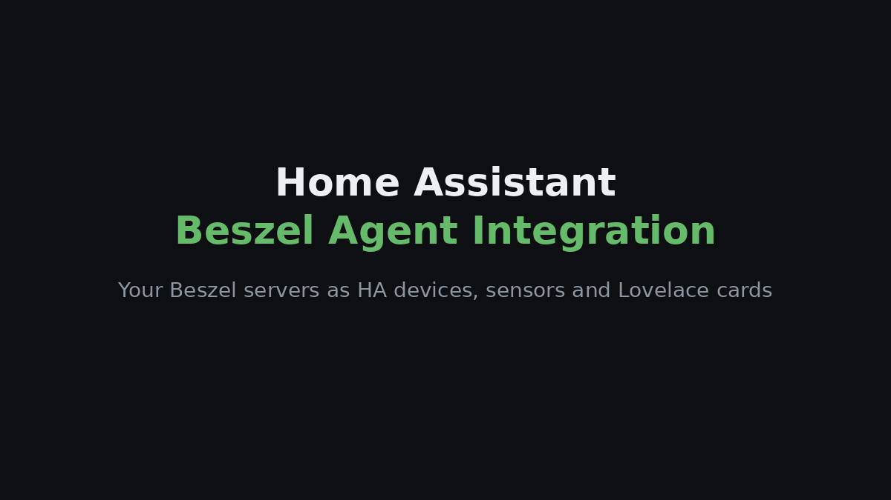
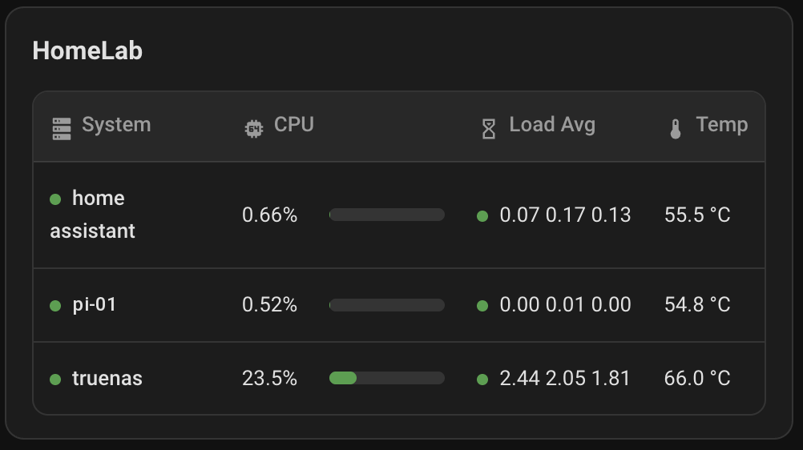

[English](README.md) · [Português](README.pt.md) · [Español](README.es.md) · [Français](README.fr.md) · **Deutsch**

# Beszel Agent Integration

Bringe die Server, die du mit [Beszel](https://github.com/henrygd/beszel) überwachst, als Geräte, Sensoren und fertige Dashboard-Karten in Home Assistant.

> Inoffizielles Projekt, nicht mit Beszel verbunden. Du brauchst einen laufenden Beszel Hub und einen Agenten auf jedem Rechner, den du sehen möchtest.

## Schnellinstallation

Suche im Home Assistant Marketplace/HACS nach **Beszel Agent Integration**.

### Weitere Möglichkeiten

1. Richte einen [Beszel Hub](https://beszel.dev/guide/getting-started) ein und [installiere den Agenten](https://beszel.dev/guide/agent-installation) auf jedem Rechner.
2. Füge dieses Repository mit dem Button oben zu HACS hinzu (Typ **Integration**), lade es herunter und starte Home Assistant neu (2026.6 oder neuer).
3. Gehe zu **Einstellungen → Geräte & Dienste → Integration hinzufügen**, wähle **Beszel Agent Integration** und melde dich mit der Hub-URL und einem normalen Beszel-Benutzer an (Nur-Lesen genügt).

Jedes System, das in Beszel als **Up** angezeigt wird, wird zu einem Home-Assistant-Gerät. Die [Installationsanleitung](docs/INSTALLATION.md) (auf Englisch) beschreibt die manuelle Installation und Einrichtung.

## Dashboard-Karten

Die Integration bringt zwei Karten mit, ohne dass eine Lovelace-Ressource hinzugefügt werden muss: eine **Maschinenkarte** für einen Server und eine **Systemtabelle** für alle.

| Maschinenkarte | Systemtabelle |
| --- | --- |
|  |  |

Mit der Option `language: de` zeigen die Karten ihren Text auf Deutsch.

## Dokumentation

Auf Englisch:

- [Installation und Einrichtung](docs/INSTALLATION.md)
- [Dashboard-Karten und Optionen](docs/CARDS.md)
- [Sensoren und Fehlerbehebung](docs/SENSORS.md)

[Problem melden](https://github.com/filipeamorimdev/home-assistant-beszel-agent-integration/issues) · [Änderungsprotokoll](CHANGELOG.md) · [Sicherheit](SECURITY.md) · [MIT-Lizenz](LICENSE)

## Danksagung

Die gesamte Überwachung übernimmt **[Beszel](https://github.com/henrygd/beszel)** von [henrygd](https://github.com/henrygd) und seinen Mitwirkenden (MIT); diese Integration zeigt nur dessen Daten in Home Assistant an. Wenn sie dir nützt, gib auch Beszel einen Stern.

Dieses Projekt ist aus [home-assistant-glances-card](https://github.com/filipeamorimdev/home-assistant-glances-card) entstanden, als ich mein Monitoring von Glances auf Beszel umgestellt habe.
