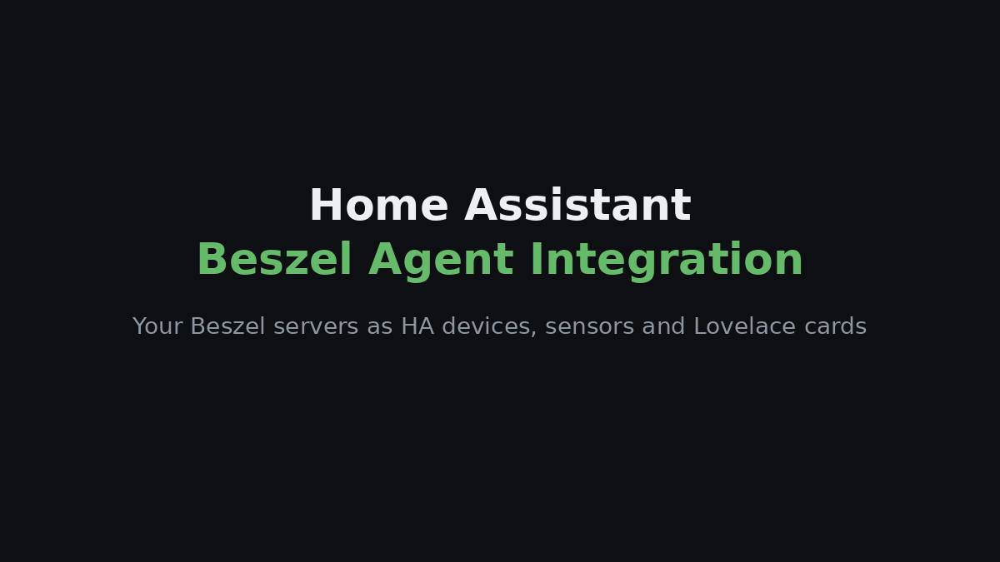
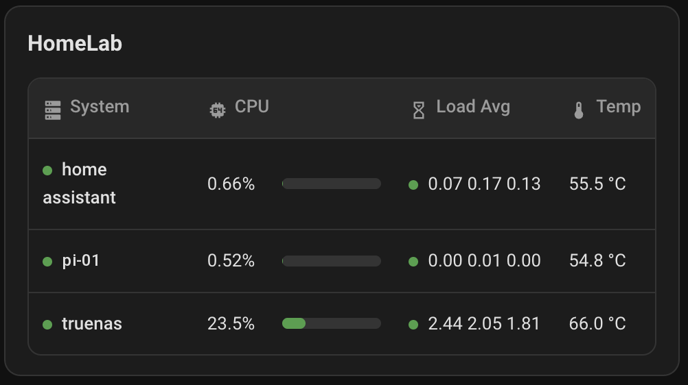

[English](README.md) · [Português](README.pt.md) · **Español** · [Français](README.fr.md) · [Deutsch](README.de.md)

# Beszel Agent Integration

Lleva los servidores que monitorizas con [Beszel](https://github.com/henrygd/beszel) a Home Assistant como dispositivos, sensores y tarjetas de panel listas para usar.

> Proyecto no oficial, sin relación con Beszel. Necesitas un Beszel Hub en funcionamiento y un agente en cada máquina que quieras ver.

## Instalación rápida

Busca **Beszel Agent Integration** en el Marketplace/HACS de Home Assistant.

### Otras opciones

1. Configura un [Beszel Hub](https://beszel.dev/guide/getting-started) e [instala el agente](https://beszel.dev/guide/agent-installation) en cada máquina.
2. Añade este repositorio a HACS con el botón de arriba (tipo **Integración**), descárgalo y reinicia Home Assistant (2026.6 o posterior).
3. Ve a **Ajustes → Dispositivos y servicios → Añadir integración**, elige **Beszel Agent Integration** e inicia sesión con la URL del Hub y un usuario normal de Beszel (basta con solo lectura).

Cada sistema que aparece como **Up** en Beszel se convierte en un dispositivo de Home Assistant. Consulta la [guía de instalación](docs/INSTALLATION.md) (en inglés) para la instalación manual y los detalles de configuración.

## Tarjetas de panel

La integración incluye dos tarjetas, sin recurso de Lovelace que añadir: una **tarjeta de máquina** para un servidor y una **tabla de sistemas** para todos.

| Tarjeta de máquina | Tabla de sistemas |
| --- | --- |
|  |  |

Las tarjetas muestran el texto en español con la opción `language: es`.

## Documentación

En inglés:

- [Instalación y configuración](docs/INSTALLATION.md)
- [Tarjetas de panel y opciones](docs/CARDS.md)
- [Sensores y solución de problemas](docs/SENSORS.md)

[Informar de un problema](https://github.com/filipeamorimdev/home-assistant-beszel-agent-integration/issues) · [Registro de cambios](CHANGELOG.md) · [Seguridad](SECURITY.md) · [Licencia MIT](LICENSE)

## Créditos

Toda la monitorización la hace **[Beszel](https://github.com/henrygd/beszel)**, de [henrygd](https://github.com/henrygd) y sus colaboradores (MIT); esta integración solo muestra sus datos en Home Assistant. Si te resulta útil, considera dar también una estrella a Beszel.

Este proyecto nació de [home-assistant-glances-card](https://github.com/filipeamorimdev/home-assistant-glances-card) cuando pasé mi monitorización de Glances a Beszel.
