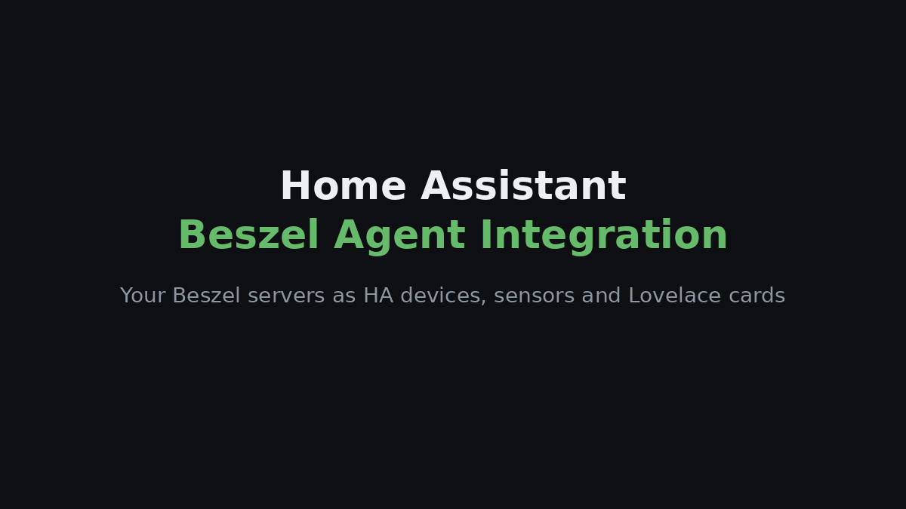
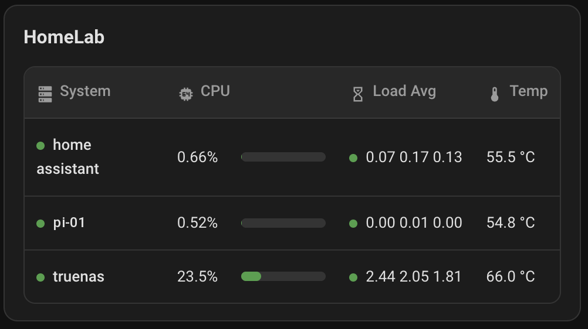

[English](README.md) · [Português](README.pt.md) · [Español](README.es.md) · **Français** · [Deutsch](README.de.md)

# Beszel Agent Integration

Intégrez dans Home Assistant les serveurs que vous surveillez avec [Beszel](https://github.com/henrygd/beszel), sous forme d’appareils, de capteurs et de cartes de tableau de bord prêtes à l’emploi.

> Projet non officiel, sans lien avec Beszel. Il vous faut un Beszel Hub en fonctionnement et un agent sur chaque machine que vous voulez suivre.

## Installation rapide

Recherchez **Beszel Agent Integration** dans le Marketplace/HACS de Home Assistant.

### Autres options

1. Installez un [Beszel Hub](https://beszel.dev/guide/getting-started) et [l’agent](https://beszel.dev/guide/agent-installation) sur chaque machine.
2. Ajoutez ce dépôt à HACS avec le bouton ci-dessus (type **Intégration**), téléchargez-le et redémarrez Home Assistant (2026.6 ou plus récent).
3. Allez dans **Paramètres → Appareils et services → Ajouter une intégration**, choisissez **Beszel Agent Integration** et connectez-vous avec l’URL du Hub et un utilisateur Beszel normal (la lecture seule suffit).

Chaque système affiché **Up** dans Beszel devient un appareil Home Assistant. Consultez le [guide d’installation](docs/INSTALLATION.md) (en anglais) pour l’installation manuelle et les détails de configuration.

## Cartes de tableau de bord

Deux cartes sont fournies avec l’intégration, sans ressource Lovelace à ajouter : une **carte machine** pour un serveur et un **tableau des systèmes** pour tous.

| Carte machine | Tableau des systèmes |
| --- | --- |
|  |  |

Les cartes affichent leur texte en français avec l’option `language: fr`.

## Documentation

En anglais :

- [Installation et configuration](docs/INSTALLATION.md)
- [Cartes de tableau de bord et options](docs/CARDS.md)
- [Capteurs et dépannage](docs/SENSORS.md)

[Signaler un problème](https://github.com/filipeamorimdev/home-assistant-beszel-agent-integration/issues) · [Journal des modifications](CHANGELOG.md) · [Sécurité](SECURITY.md) · [Licence MIT](LICENSE)

## Crédits

Toute la surveillance est assurée par **[Beszel](https://github.com/henrygd/beszel)**, de [henrygd](https://github.com/henrygd) et ses contributeurs (MIT) ; cette intégration se contente d’afficher ses données dans Home Assistant. Si elle vous est utile, pensez à mettre aussi une étoile à Beszel.

Ce projet est né de [home-assistant-glances-card](https://github.com/filipeamorimdev/home-assistant-glances-card) lorsque j’ai migré ma surveillance de Glances vers Beszel.
