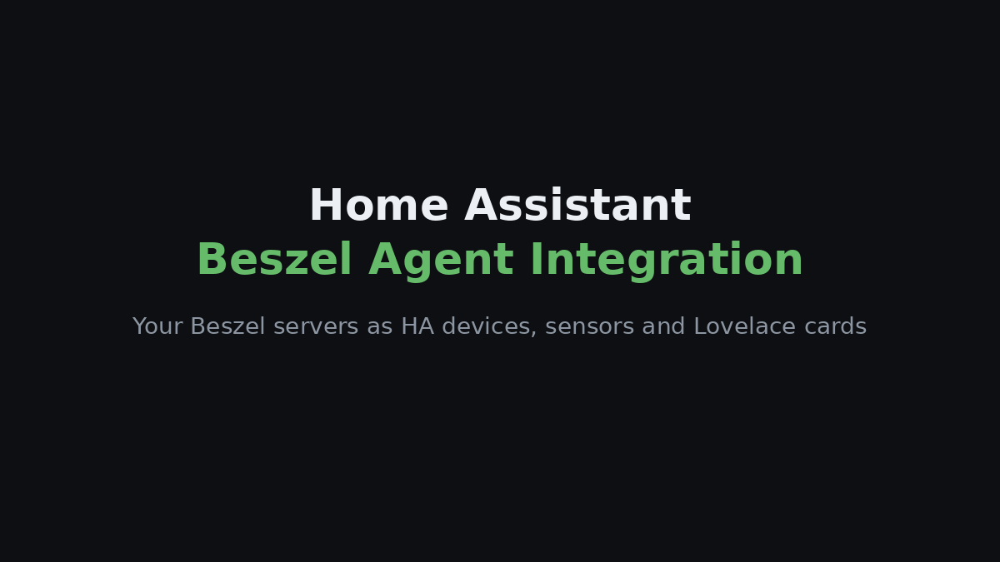
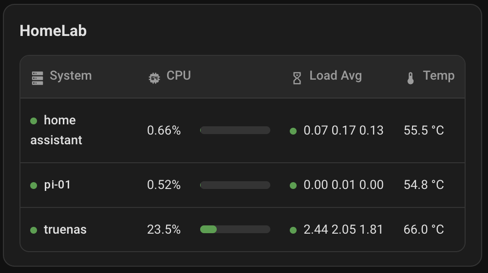

**English** · [Português](README.pt.md) · [Español](README.es.md) · [Français](README.fr.md) · [Deutsch](README.de.md)

# Beszel Agent Integration

Bring the servers you monitor with [Beszel](https://github.com/henrygd/beszel) into Home Assistant as devices, sensors and ready-made dashboard cards.

> Unofficial project, not affiliated with Beszel. You need a running Beszel Hub with an agent on every machine you want to see.

## Quick installation

Search for **Beszel Agent Integration** in Home Assistant Marketplace/HACS.

### Other options

1. Set up a [Beszel Hub](https://beszel.dev/guide/getting-started) and [install the agent](https://beszel.dev/guide/agent-installation) on each machine.
2. Add this repository to HACS with the button above (type **Integration**), download it and restart Home Assistant (2026.6 or newer).
3. Go to **Settings → Devices & services → Add integration**, pick **Beszel Agent Integration** and sign in with your Hub URL and a normal Beszel user (readonly is enough).

Every system that shows as **Up** in Beszel becomes a Home Assistant device. See the [installation guide](docs/INSTALLATION.md) for manual install and setup details.

## Dashboard cards

Two cards come with the integration, with no Lovelace resource to add: a **machine card** for one server and a **systems table** for all of them.

| Machine card | Systems table |
| --- | --- |
|  |  |

## Documentation

- [Installation and setup](docs/INSTALLATION.md)
- [Dashboard cards and options](docs/CARDS.md)
- [Sensors and troubleshooting](docs/SENSORS.md)

[Report an issue](https://github.com/filipeamorimdev/home-assistant-beszel-agent-integration/issues) · [Changelog](CHANGELOG.md) · [Security](SECURITY.md) · [MIT license](LICENSE)

## Credits

All monitoring is done by **[Beszel](https://github.com/henrygd/beszel)** by [henrygd](https://github.com/henrygd) and its contributors (MIT); this integration only shows its data in Home Assistant. If you find it useful, consider starring Beszel too.

This project grew out of [home-assistant-glances-card](https://github.com/filipeamorimdev/home-assistant-glances-card) when I moved my monitoring from Glances to Beszel.
