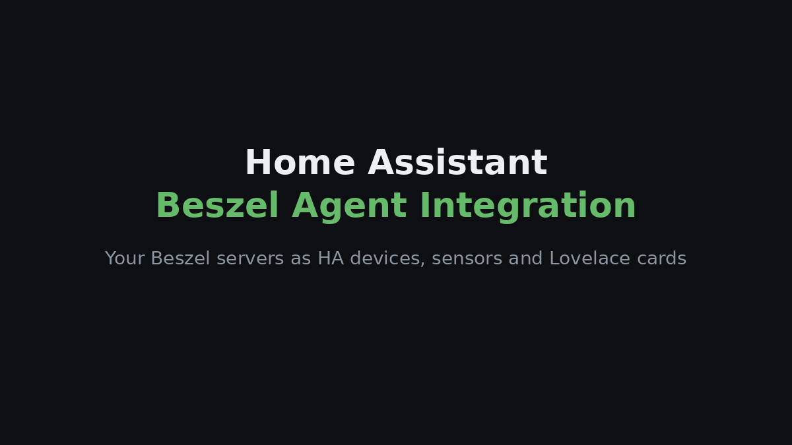
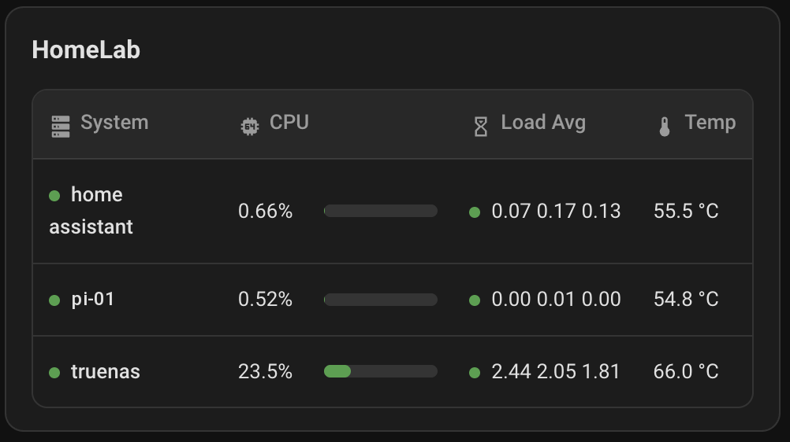

[English](README.md) · **Português** · [Español](README.es.md) · [Français](README.fr.md) · [Deutsch](README.de.md)

# Beszel Agent Integration

Traga os servidores que monitoriza com o [Beszel](https://github.com/henrygd/beszel) para o Home Assistant como dispositivos, sensores e cartões de dashboard prontos a usar.

> Projeto não oficial, sem ligação ao Beszel. Precisa de um Beszel Hub em funcionamento e de um agente em cada máquina que quer ver.

## Instalação rápida

Procure **Beszel Agent Integration** no Marketplace/HACS do Home Assistant.

### Outras opções

1. Configure um [Beszel Hub](https://beszel.dev/guide/getting-started) e [instale o agente](https://beszel.dev/guide/agent-installation) em cada máquina.
2. Adicione este repositório ao HACS com o botão acima (tipo **Integração**), descarregue-o e reinicie o Home Assistant (2026.6 ou mais recente).
3. Vá a **Definições → Dispositivos e serviços → Adicionar integração**, escolha **Beszel Agent Integration** e inicie sessão com o URL do Hub e um utilizador normal do Beszel (só de leitura é suficiente).

Cada sistema que aparece como **Up** no Beszel torna-se um dispositivo do Home Assistant. Consulte o [guia de instalação](docs/INSTALLATION.md) (em inglês) para a instalação manual e detalhes de configuração.

## Cartões de dashboard

A integração inclui dois cartões, sem recurso Lovelace a adicionar: um **cartão de máquina** para um servidor e uma **tabela de sistemas** para todos.

| Cartão de máquina | Tabela de sistemas |
| --- | --- |
|  |  |

Os cartões mostram o texto em português com a opção `language: pt`.

## Documentação

Em inglês:

- [Instalação e configuração](docs/INSTALLATION.md)
- [Cartões de dashboard e opções](docs/CARDS.md)
- [Sensores e resolução de problemas](docs/SENSORS.md)

[Reportar um problema](https://github.com/filipeamorimdev/home-assistant-beszel-agent-integration/issues) · [Changelog](CHANGELOG.md) · [Segurança](SECURITY.md) · [Licença MIT](LICENSE)

## Créditos

Toda a monitorização é feita pelo **[Beszel](https://github.com/henrygd/beszel)** de [henrygd](https://github.com/henrygd) e dos seus contribuidores (MIT); esta integração apenas mostra os seus dados no Home Assistant. Se lhe for útil, considere dar também uma estrela ao Beszel.

Este projeto nasceu do [home-assistant-glances-card](https://github.com/filipeamorimdev/home-assistant-glances-card) quando passei a minha monitorização do Glances para o Beszel.
