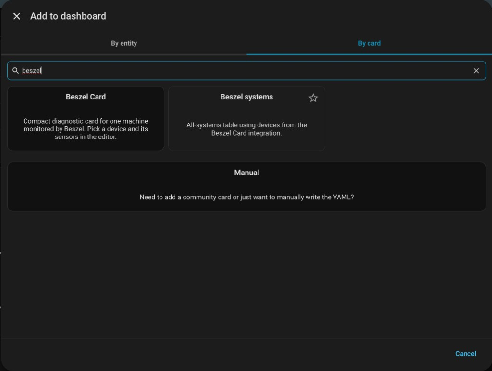
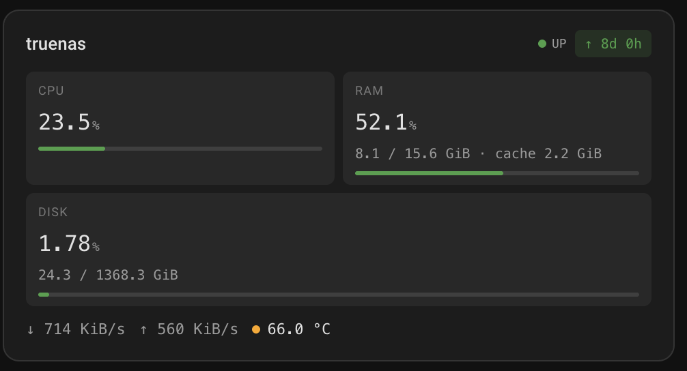
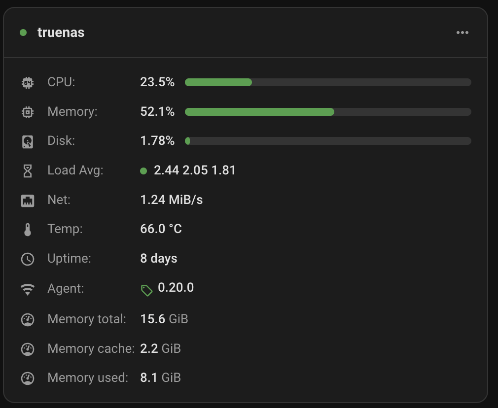
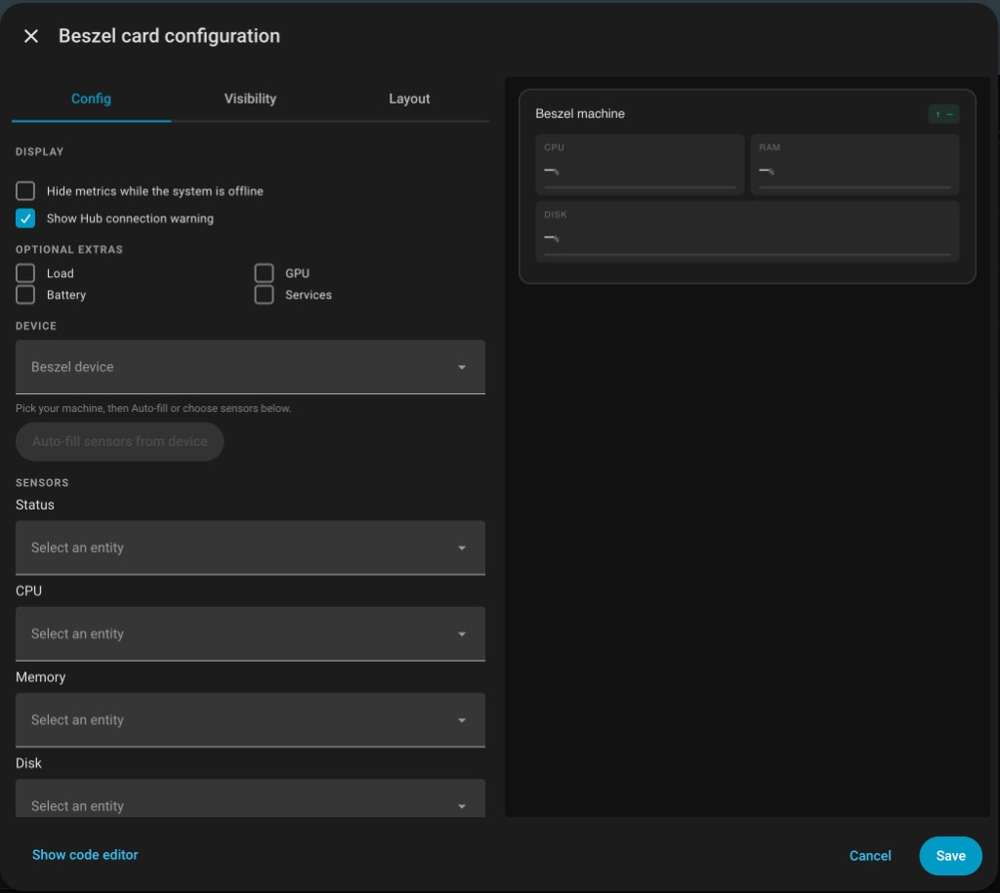
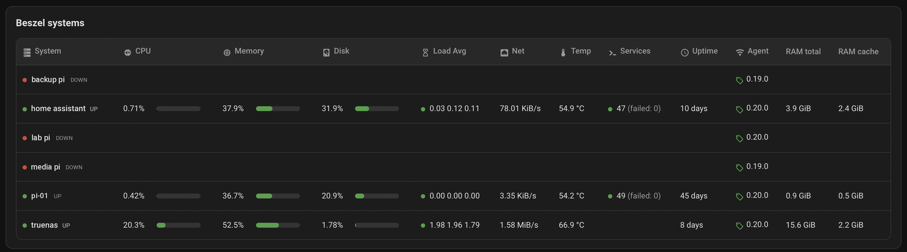
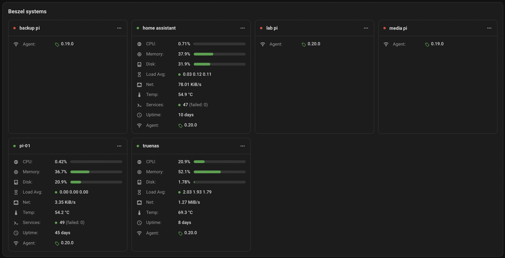
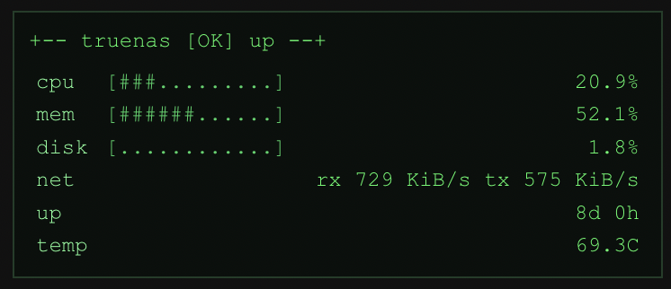
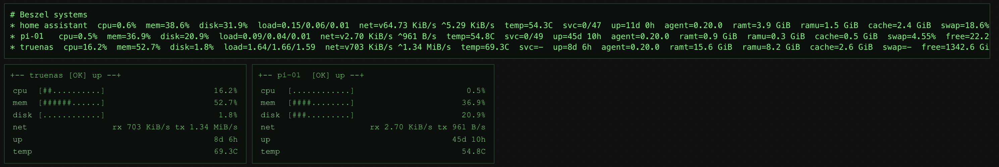

# Dashboard cards

[← Back to README](../README.md)

Both cards appear in the Lovelace card picker under **Add card**, with a visual editor. Pick a device and the sensors are filled in for you.



## Machine card

One server, as compact tiles or as a detailed list.

| Compact tiles | Detailed list |
| --- | --- |
|  |  |

- **Compact** (default): CPU, RAM and disk tiles with meters and used / total sizes, plus network speed, temperature and uptime.
- **Detailed:** the rows of a Beszel system card (CPU, memory, disk, load, network, temperature, services, uptime, agent) plus any extra metrics you add.
- Meters change colour at the warning / critical thresholds (65% / 90% by default).
- Network shows Beszel's combined total. `split_network: true` shows download ↓ and upload ↑ separately.
- Values use the unit and display precision set in each sensor's settings (without a display precision the cards keep their own rounding). Sensors left on the default bytes (B, B/s) are scaled automatically (KiB/s, MiB/s…).
- Sensors without a value are hidden. `show_empty_rows: true` keeps them, blank.
- Both options apply to every layout, terminal included.
- `hide_when_offline: true` hides the whole card while the machine is down. It stays visible in edit mode.
- `language` sets the language of this card only; see [Language](#language).

```yaml
type: custom:beszel-machine-card
device_id: 0123456789abcdef0123456789abcdef
title: TrueNAS
layout: detailed          # or compact (default)
language: pt              # en (default) | pt | es | fr | de
hide_when_offline: false
```



## Systems table

Beszel's "All Systems" view for every machine: a sortable table, or a grid of cards that suits phones and narrow columns.

| Table | Grid |
| --- | --- |
|  |  |

- Click a header to sort; click a row to open the device page.
- Choose only the columns you need. Columns no machine reports are hidden automatically.
- Offline machines stay in the list with blank metrics. `hide_when_offline: true` removes them.
- `only_alerts: true` keeps only machines with an amber or red indicator (high usage, hot CPU, low battery, a failed service, a pending status) and hides the card when there are none. It stays visible in edit mode.

```yaml
type: custom:beszel-systems-table-card
title: Homelab
layout: auto              # table | grid | auto
language: de              # en (default) | pt | es | fr | de
columns: [cpu, load, temperature]
hide_when_offline: true
only_alerts: false
```

## Language

Each card has its own **Language of this card** setting in the editor (`language: en | pt | es | fr | de`, English when unset), so one dashboard can be in Portuguese and another in German. It is not an integration setting.

- Translated: row, tile and column labels, the status word, "days" in uptime, the failed-services note, Yes / No, the card's own messages (Hub unreachable, no systems, offline), and the names of every extra metric: per core, per drive, per pool, per container, per service, per monitor, alerts and the rest. "Drive sda temperature" becomes "Unidade sda – temperatura" on a Portuguese card.
- Not translated: titles you typed, the names of your own things inside a metric (`sda`, `tank`, `nginx`), entities you renamed in Home Assistant, and text values Beszel reports (a container's `running`, a drive's `PASSED`).
- The terminal style keeps its short English abbreviations (`cpu`, `mem`, `net`…), and the card editors are in English.

## Terminal style

Choose **Terminal** in either editor's Layout dropdown (`style: terminal`) for a green monospace look that also renders on very old browsers.

| Machine card | Systems list |
| --- | --- |
|  |  |

For old tablets where custom cards don't run at all (Android 4), paste the bundled [native terminal card](../custom_components/beszel_machine_card/frontend/beszel-native-terminal.yaml) into a **Manual** card instead.
