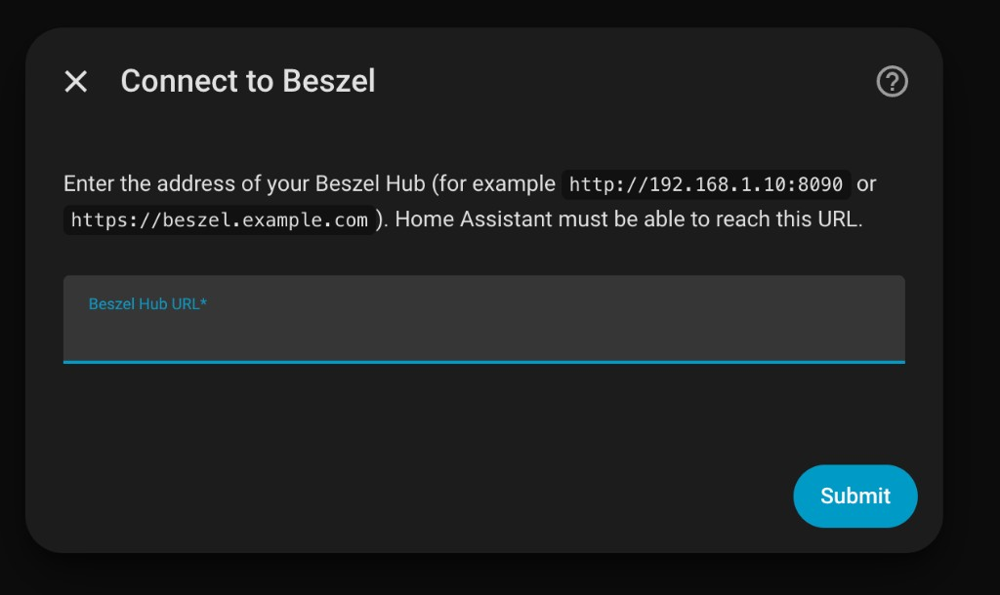
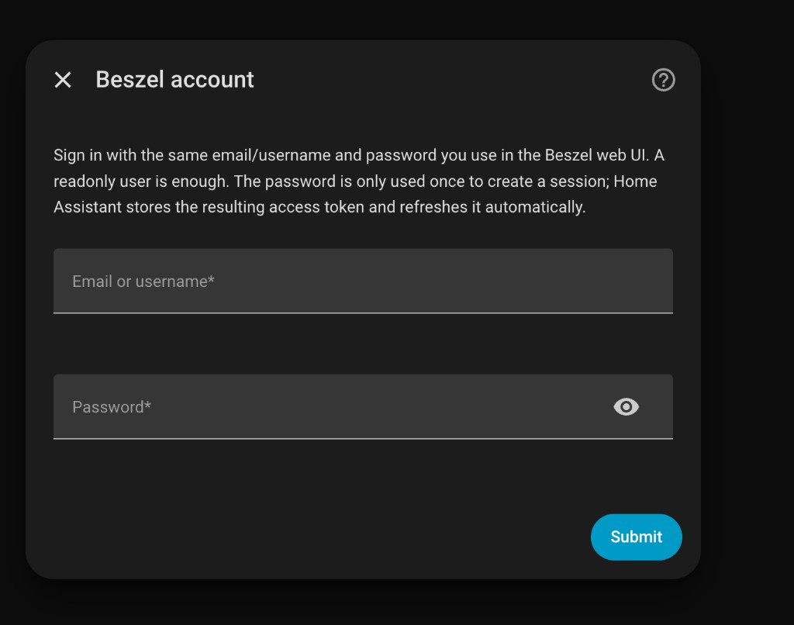

# Installation and setup

[← Back to README](../README.md)

## Requirements

This integration only *reads* from Beszel, so set Beszel up first:

1. A **Beszel Hub** that Home Assistant can reach ([getting started](https://beszel.dev/guide/getting-started)).
2. The **Beszel agent on every machine** you want to monitor, each added to the Hub ([agent installation](https://beszel.dev/guide/agent-installation)). Machines without an agent do not show up.
3. A **Beszel user** (readonly is enough) that can see those systems.
4. **Home Assistant 2026.6 or newer.**

Once a machine shows as **Up** in the Beszel web UI, it appears in Home Assistant.

## Install

Search for **Beszel Agent Integration** in Home Assistant Marketplace/HACS.

### HACS (custom repository)

1. In HACS, open the **⋮** menu → **Custom repositories**.
2. Add `https://github.com/filipeamorimdev/home-assistant-beszel-agent-integration` with type **Integration**.
3. Search for **Beszel Agent Integration**, download it and restart Home Assistant.

### Manual

1. Download the latest zip from [Releases](https://github.com/filipeamorimdev/home-assistant-beszel-agent-integration/releases).
2. Copy `custom_components/beszel_machine_card` into your Home Assistant `config/custom_components/` folder.
3. Restart Home Assistant.

The integration loads its dashboard cards itself, so there is no Lovelace resource to add. After an update, restart and hard-refresh your browser.

## Connect your Hub

Go to **Settings → Devices & services → Add integration** and search for **Beszel Agent Integration**. Enter the Hub address Home Assistant can reach, then sign in with your Beszel account.

| Hub URL | Account |
| --- | --- |
|  |  |

- Use a normal Beszel user, not a PocketBase `_superusers` account. Your password is used once to get a session and is never stored.
- Use HTTPS if the Hub is reachable beyond your LAN. Home Assistant shows a repair warning for a plain `http://` address outside your local network.
- If the session can't be refreshed, Home Assistant asks you to sign in again.
- **Language:** each dashboard card has its own language setting (English, Portuguese, Spanish, French or German), so there is nothing to choose here. The setup dialogs follow your Home Assistant profile language, and Home Assistant names the main sensors in its own language. Detailed sensors (per core, per disk, per container…) keep English names.

Next: [add the dashboard cards](CARDS.md).
